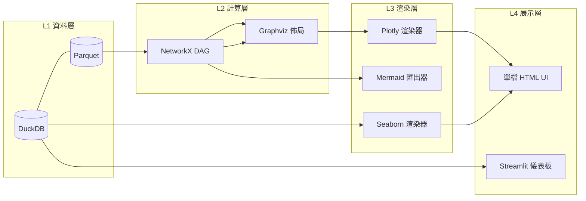

# 工作流架構視覺化系統 — 實作計畫（Workflow Architecture Visualization Plan）

> 目標：以純本地、開源免費技術棧，建構一套「功能資訊流 + Interface 架構」的動態工作流圖表系統，輸出為可互動的 HTML UI，並整合 Plotly（互動）與 Seaborn（統計分析）雙渲染引擎。

---

## 1. 技術選型（從 Top 10 本地免費庫精選）

| 層級 | 選用庫 | 角色 | 選型理由 |
|---|---|---|---|
| 拓撲計算 | **NetworkX** | DAG 建模、節點分層、路徑分析 | 純 Python、零 UI 依賴，工作流結構計算效能最高 |
| 自動佈局 | **Graphviz (DOT)** | 層次式節點排列、避免連線交叉 | 業界標準自動佈局引擎，輸出位置座標供 Plotly 使用 |
| 互動渲染 | **Plotly (Python)** | HTML 動態圖、hover、點擊展開、縮放 | 輸出獨立 HTML，無需伺服器，支援 to_html() 嵌入 |
| 統計分析圖 | **Seaborn / Matplotlib** | 靜態熱力圖、分佈圖、瓶頸分析 | 與 Pandas/DuckDB 管線無縫整合 |
| 文件流程圖 | **Mermaid.js** | Markdown 內嵌流程圖、架構文件 | 文字即圖表，適合版本控管與文件自動生成 |
| 資料層 | **DuckDB + Parquet** | 工作流定義、執行歷程、指標存儲 | 本地優先、SQL 查詢、增量載入 |

**核心策略：NetworkX + Graphviz 負責「算位置」，Plotly 負責「畫出來」。** Graphviz 的 `dot` 引擎計算出的節點座標，直接餵給 Plotly 的 `scatter` + `shapes`（連線）繪製，兼具自動佈局專業度與 Plotly 互動性。

---

## 2. 系統架構（四層分離）

```
┌──────────────────────────────────────────────────────┐
│  L4 展示層 (Presentation)                            │
│  HTML UI (單檔輸出) / Streamlit 儀表板               │
│  ├─ Plotly 互動工作流圖 (節點拖曳、hover、鑽取)       │
│  └─ Seaborn 靜態分析圖 (瓶頸熱力圖、時序分佈)         │
├──────────────────────────────────────────────────────┤
│  L3 渲染層 (Rendering)                               │
│  renderer/plotly_renderer.py  → 互動 HTML            │
│  renderer/seaborn_renderer.py → 靜態 PNG/SVG         │
│  renderer/mermaid_exporter.py → .mmd 文件圖          │
├──────────────────────────────────────────────────────┤
│  L2 計算層 (Computation)                             │
│  topology/builder.py    → NetworkX DAG 建模          │
│  topology/layout.py     → Graphviz 座標計算          │
│  topology/analytics.py  → 分層、中心性、關鍵路徑      │
├──────────────────────────────────────────────────────┤
│  L1 資料層 (Data)                                     │
│  workflow.duckdb (節點表/邊表/指標表)                 │
│  workflows/*.parquet (工作流定義版本化存儲)           │
└──────────────────────────────────────────────────────┘
```

---

## 3. 資訊流格式（Interface Schema）

工作流以 JSON/Parquet 定義，三張核心表：

### 3.1 節點表（Nodes）
```json
{
  "node_id": "etl_load_quotes",
  "node_type": "transform",       // source | transform | model | sink | decision
  "layer": "data_pipeline",       // 資料層分組（決定顏色）
  "label": "載入股價資料",
  "interface": {                  // Interface 架構資訊
    "input_schema": "parquet://quotes/*.parquet",
    "output_schema": "duckdb://main.quotes",
    "api": "python:load_quotes(df) -> df"
  },
  "metrics": {"runtime_sec": 1.2, "status": "ok"}
}
```

### 3.2 邊表（Edges）
```json
{
  "from": "etl_load_quotes",
  "to": "feat_engineering",
  "edge_type": "dataflow",        // dataflow | control | feedback
  "throughput": 12500              // 每秒筆數（決定連線粗細）
}
```

### 3.3 指標表（Metrics，時間序列）
```json
{
  "node_id": "feat_engineering",
  "ts": "2026-11-07T09:00:00+08:00",
  "runtime_sec": 3.4,
  "memory_mb": 512,
  "rows_processed": 1250000
}
```

此 Schema 同時是 **UI 的資料合約**：HTML UI 只讀此格式，任何工作流（ETL、AI Pipeline、Agent 編排）只要符合 Schema 即可視覺化。

---

## 4. 動態圖顯示設計（HTML UI）

### 4.1 Plotly 互動工作流圖
- **節點**：`go.Scatter` + `mode="markers+text"`，節點大小 = 中心性（PageRank），顏色 = 節點類型
- **連線**：`go.Scatter(mode="lines")`，線寬 = 流量，虛線 = 回饋迴路
- **互動**：hover 顯示 Interface 詳情（輸入/輸出 schema、API 簽名）；點擊節點 → 下鑽至 Seaborn 該節點的時序效能圖
- **圖層切換**：dropdown 選單切換「功能視圖 / 資料流視圖 / Interface 依賴視圖」
- **輸出**：`fig.write_html("workflow.html", include_plotlyjs="cdn")` 單檔交付，或 `include_plotlyjs=True` 完全離線

### 4.2 Seaborn 靜態分析圖
- **熱力圖**：節點 × 時段的執行時間熱力圖（`sns.heatmap`），快速定位瓶頸
- **分佈圖**：各節點 runtime 的箱型圖/小提琴圖，比較離群值
- **整合方式**：轉為 base64 內嵌至 HTML，或由 Streamlit `st.pyplot` 直接展示

### 4.3 UI 殼（兩種部署形態）
| 形態 | 技術 | 適用場景 |
|---|---|---|
| 單檔 HTML | Plotly to_html + base64 圖 | 交付給他人、無環境依賴 |
| 本地儀表板 | Streamlit + plotly_chart | 自己日常監控、即時刷新 |

---

## 5. 實作階段（Phase Plan）

### Phase 1：資料層與拓撲核心（約 2–3 天）
- [ ] 定義 JSON Schema 與 DuckDB 資料表（nodes / edges / metrics）
- [ ] `topology/builder.py`：JSON → NetworkX DiGraph
- [ ] 驗證 DAG 合法性（`nx.is_directed_acyclic_graph`）、環路偵測

### Phase 2：佈局與渲染（約 3–4 天）
- [ ] `topology/layout.py`：呼叫 Graphviz `dot` 取得節點座標
- [ ] `renderer/plotly_renderer.py`：座標 → Plotly 圖形（節點/連線/hover）
- [ ] `renderer/seaborn_renderer.py`：metrics 表 → 熱力圖 + 分佈圖

### Phase 3：HTML UI 組裝（約 2 天）
- [ ] Plotly HTML 與 Seaborn 圖整合為單一 HTML（Jinja2 模板）
- [ ] Dropdown 圖層切換、節點下鑽連動
- [ ] （可選）包裝為 Streamlit 頁面，加入 DuckDB 查詢過濾器

### Phase 4：自動化與文件（約 1–2 天）
- [ ] `mermaid_exporter.py`：同一份 Schema 自動生成 Mermaid 架構文件圖
- [ ] PowerShell 腳本一鍵重建：資料 → 圖表 → HTML
- [ ] 以您現有的增量 ETL 管線接上 metrics 時序數據

---

## 6. 驗收標準

1. **單一 HTML 檔**雙擊即可離線開啟，含互動工作流圖與統計圖
2. **Schema 驅動**：換一份工作流 JSON，不需改程式碼即可重新渲染
3. **拓撲正確**：Graphviz 佈局無連線交叉、層次清晰
4. **指標連動**：hover 節點可見 Interface 詳情，熱力圖可定位最慢節點
5. **全離線**：`include_plotlyjs=True`，無任何 CDN 或雲端依賴

---

## 7. 架構總覽（Mermaid）



---

*技術棧總覽：Python · NetworkX · Graphviz · Plotly · Seaborn · Mermaid.js · DuckDB · Parquet · Streamlit · Jinja2 — 全部本地、開源、免費。*
